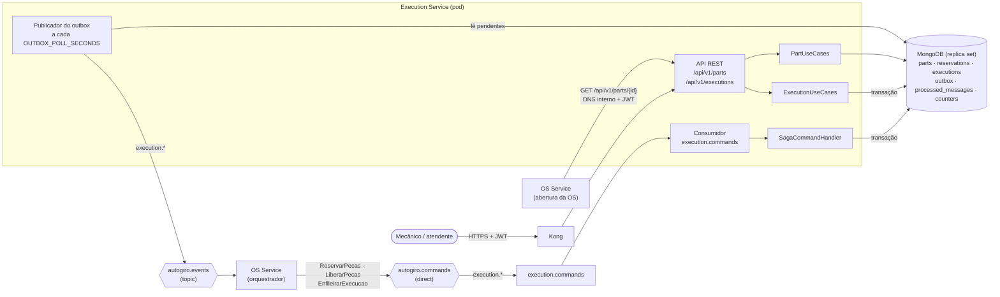
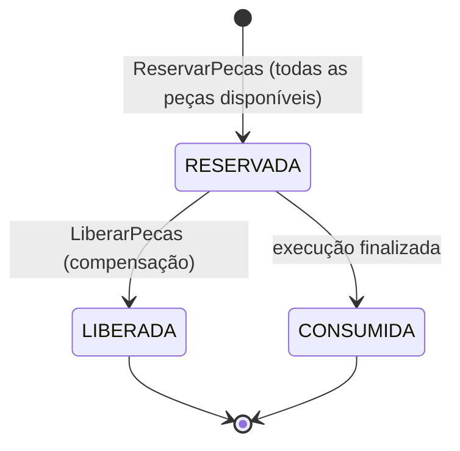
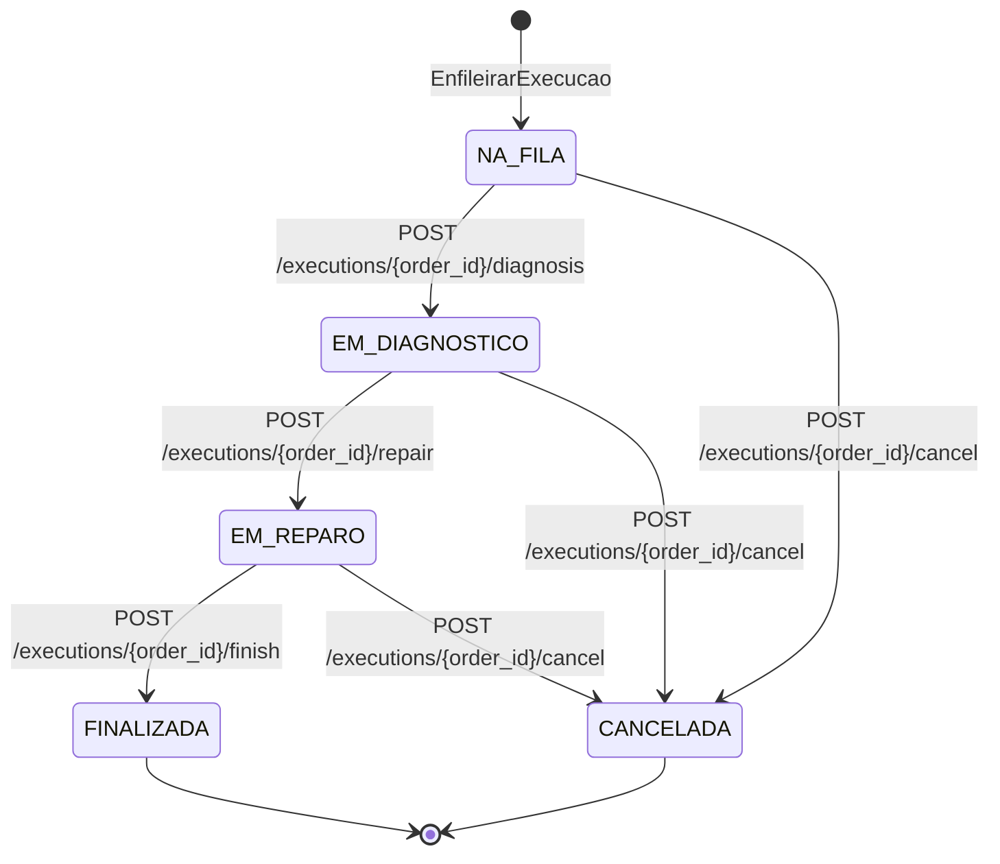

# Arquitetura do Execution Service

O Execution Service é o dono da **produção** na plataforma AutoGiro: catálogo de peças e
estoque, reservas de peças por ordem de serviço (OS), fila da oficina e o andamento da
execução (diagnóstico, reparo e finalização).

Ele é **participante** da Saga orquestrada pelo
[OS Service](https://github.com/Figueiraa/autogiro-os-service): recebe comandos pelo RabbitMQ e
responde com eventos. O mecânico conduz a execução pela API, e cada passo vira um evento para o
orquestrador. A visão geral da plataforma fica na
[documentação do OS Service](https://github.com/Figueiraa/autogiro-os-service/blob/main/docs/README.md).

| | |
|---|---|
| **É dono de** | Peças e estoque (`parts`), reservas (`reservations`) e execuções (`executions`) |
| **Recebe dos outros serviços** | Peças pedidas (`ReservarPecas`); veículo, serviços, peças e observações da OS (`EnfileirarExecucao`) |
| **Entrega aos outros serviços** | Nome e preço das peças reservadas, posição na fila e o andamento da execução, sempre por evento. O catálogo de peças também é consultado pelo OS Service por HTTP na abertura da OS |
| **Banco** | MongoDB (Atlas M0 em produção), em replica set, com transações |

## Componentes

A API (FastAPI), o consumidor de comandos e o publicador do outbox sobem juntos no `lifespan`
da aplicação, que também garante os índices. Sem `RABBITMQ_URL`, só a API sobe; os eventos
ficam no outbox até o broker ser configurado.

O código segue Clean Architecture:

| Camada | Pasta | Conteúdo |
|---|---|---|
| Domínio | `app/domain/` | Entidades `Part`, `Reservation` e `Execution`, com as transições de estado; exceções de negócio |
| Aplicação | `app/application/` | Casos de uso de peças, de execução e dos comandos da Saga; envelope das mensagens; porta `UnitOfWorkPort` |
| Infraestrutura | `app/infrastructure/` | MongoDB (pymongo assíncrono), seed, RabbitMQ, métricas e rastreamento |
| Interfaces | `app/interfaces/http/` | Rotas, esquemas, autenticação JWT e tratamento de erros |

## Por que MongoDB

- **A execução é um documento que cresce.** Cada OS tem um documento em `executions` com o
  veículo, os serviços, as peças e uma linha do tempo (`timeline`) que ganha uma entrada a cada
  passo do mecânico, com observação livre. Ler a execução é ler um documento, sem junções.
- **Reserva tudo ou nada sem venda dupla.** A reserva de cada peça é uma atualização
  condicional e atômica no próprio documento da peça: o `$inc` em `reserved_quantity` só
  acontece se `stock_quantity - reserved_quantity` ainda comportar a quantidade
  (`$expr` no filtro). Duas OS disputando a última unidade nunca levam as duas.
- **Transações multi-documento.** Reservar várias peças, criar a reserva, gravar o evento no
  outbox e registrar o comando no inbox precisam valer juntos. O MongoDB oferece isso em
  replica set: o Atlas M0 já é um, e localmente o `docker-compose.yml` sobe o Mongo com
  `--replSet rs0` e inicia o replica set no healthcheck.

Toda operação de escrita roda numa unidade de trabalho
([`MongoUnitOfWork`](../app/infrastructure/mongo/database.py)): uma sessão com transação,
confirmada se o bloco termina bem e abortada se der erro.

## Modelo de dados

Banco `MONGODB_DATABASE` (padrão `autogiro_execution`). As coleções e campos abaixo são os
gravados por [`repositories.py`](../app/infrastructure/mongo/repositories.py).

| Coleção | Documento |
|---|---|
| `parts` | `{_id: int, name, description, unit, unit_price, stock_quantity, reserved_quantity, created_at, updated_at}` |
| `counters` | `{_id: "parts", seq}`: sequência dos ids numéricos de peças |
| `reservations` | `{order_id, saga_id, status: RESERVADA│LIBERADA│CONSUMIDA, items: [{part_id, name, quantity, unit_price}], created_at, updated_at}` |
| `executions` | `{order_id, saga_id, vehicle: {plate, brand, model}, services: [...], parts: [...], notes, status, cancel_reason, queued_at, timeline: [{status, at, note}]}` |
| `outbox` | `{_id: message_id, type, exchange, routing_key, body, trace_context, created_at, published_at}` |
| `processed_messages` | `{_id: message_id, processed_at}` |

O **disponível** de uma peça é `stock_quantity - reserved_quantity`: o reservado está no
estoque, mas prometido a OS ainda não executadas.

### Índices

Criados por `ensure_indexes`, chamado na subida da API e pelo seed:

| Coleção | Índice | Para quê |
|---|---|---|
| `reservations` | `order_id` (único) | Uma reserva por OS |
| `executions` | `order_id` (único) | Uma execução por OS |
| `executions` | `(status, queued_at)` | Fila por status, em ordem de chegada, e contagem da capacidade |
| `outbox` | `(published_at, created_at)` | Eventos pendentes, na ordem de gravação |

`parts`, `outbox` e `processed_messages` usam o `_id` como chave (id da peça e `message_id`).

### Seed

`python -m app.infrastructure.mongo.seed` cria os índices e um catálogo de demonstração com
8 peças (ids 1 a 8: óleo, filtros, pastilhas, correia, bomba d'água, fluido de freio e
palheta), e ajusta `counters` para que novas peças continuem a numeração a partir de 9. É
idempotente: usa `$setOnInsert`, então rodar de novo não duplica nem sobrescreve o estoque.
Roda no `docker compose up` e, no Kubernetes, num *init container* antes da API.

## Máquinas de estado

Só o Execution muda estes estados. O OS Service fica sabendo pelos eventos.

### Reserva

| Transição | Efeito no estoque |
|---|---|
| → `RESERVADA` | `reserved_quantity += quantidade` em cada peça |
| `RESERVADA → LIBERADA` | `reserved_quantity -= quantidade`: volta ao disponível |
| `RESERVADA → CONSUMIDA` | `stock_quantity -= quantidade` e `reserved_quantity -= quantidade`: a peça foi usada no reparo |

Se alguma peça falta, nenhuma reserva é criada e o serviço responde `PecasIndisponiveis`.

### Execução

Cada transição acrescenta uma entrada à `timeline` (status, instante e observação) e grava um
evento no outbox. Uma transição fora do diagrama responde `422`.

## Mensageria

Todas as mensagens usam o envelope definido em
[`app/application/messages.py`](../app/application/messages.py), o mesmo do
[OS Service](https://github.com/Figueiraa/autogiro-os-service/blob/main/app/application/messages.py):
`message_id`, `type`, `kind` (`command` ou `event`), `version`, `saga_id`, `order_id`,
`causation_id`, `occurred_at`, `producer` e `payload`.

### Topologia

| Recurso | Tipo | Uso |
|---|---|---|
| `autogiro.commands` | exchange `direct`, durável | Comandos do orquestrador |
| `autogiro.events` | exchange `topic`, durável | Eventos dos participantes |
| `execution.commands` | fila durável | Ligada a `execution.reservar-pecas`, `execution.liberar-pecas` e `execution.enfileirar-execucao` |
| `execution.commands.retry` | fila durável, `x-message-ttl` = `MESSAGE_RETRY_DELAY_MS` (5000) | Espera antes de nova tentativa; ao expirar, volta para `execution.commands` |
| `execution.commands.dlq` | fila durável | Mensagens inválidas ou que falharam em todas as tentativas |

Publicação com *publisher confirms*, mensagens persistentes e `prefetch_count = 10` no consumo.

### Comandos consumidos

| Comando | Routing key | `payload` | Efeito | Resposta |
|---|---|---|---|---|
| `ReservarPecas` | `execution.reservar-pecas` | `items: [{part_id, quantity}]` | Reserva todas as peças ou nenhuma | `PecasReservadas` ou `PecasIndisponiveis` |
| `LiberarPecas` (compensação) | `execution.liberar-pecas` | `reason` | Devolve ao disponível o que estava reservado | `PecasLiberadas` |
| `EnfileirarExecucao` | `execution.enfileirar-execucao` | `vehicle: {plate, brand, model}`, `services: [{service_type_id, name, quantity}]`, `parts: [{part_id, name, quantity}]`, `notes` | Cria a execução `NA_FILA`, se houver vaga | `ExecucaoEnfileirada` ou `EnfileiramentoRecusado` |

Mensagens de outro tipo que cheguem à fila são registradas como processadas e ignoradas.

### Eventos publicados

Todos vão para `autogiro.events` com routing key `execution.<evento>`.

| Evento | Routing key | `payload` | Quando |
|---|---|---|---|
| `PecasReservadas` | `execution.pecas-reservadas` | `items: [{part_id, name, quantity, unit_price}]` | Todas as peças reservadas (lista vazia se a OS não pediu peças) |
| `PecasIndisponiveis` | `execution.pecas-indisponiveis` | `missing: [{part_id, requested, available, reason}]`, com `reason` `SEM_ESTOQUE` ou `NAO_ENCONTRADA` | Alguma peça falta; nada foi reservado |
| `PecasLiberadas` | `execution.pecas-liberadas` | `released` | Compensação concluída (`false` se não havia reserva ativa) |
| `ExecucaoEnfileirada` | `execution.execucao-enfileirada` | `position` | OS entrou na fila |
| `EnfileiramentoRecusado` | `execution.enfileiramento-recusado` | `reason: FILA_CHEIA` | Capacidade da fila atingida |
| `DiagnosticoIniciado` | `execution.diagnostico-iniciado` | `note` | Mecânico iniciou o diagnóstico |
| `ReparoIniciado` | `execution.reparo-iniciado` | `note` | Mecânico iniciou o reparo |
| `ExecucaoFinalizada` | `execution.execucao-finalizada` | `note` | Reparo concluído; reserva consumida |
| `ExecucaoCancelada` | `execution.execucao-cancelada` | `reason` | Mecânico cancelou a execução |

Os quatro primeiros respondem a um comando e levam `causation_id` igual ao `message_id` dele.
Os quatro últimos nascem nas rotas do mecânico.

### Retry e DLQ

O consumidor ([`consumer.py`](../app/infrastructure/messaging/consumer.py)) decide o destino
de cada entrega:

- **Envelope inválido** (JSON malformado, campo obrigatório ausente, `version` maior que a
  suportada): direto para `execution.commands.dlq`.
- **Falha técnica** (exceção, banco fora, conflito de escrita na transação): a transação é
  abortada e a mensagem vai para `execution.commands.retry` com `x-retry-count` incrementado.
  Depois de `MESSAGE_MAX_RETRIES` (3) novas tentativas, vai para a DLQ com o erro em `x-error`.
- **Falha de negócio** (peça indisponível, fila cheia) não é exceção: é um evento normal que o
  orquestrador trata.

O `ack` da mensagem original só sai depois do commit ou depois de a cópia estar a salvo na fila
de retry ou na DLQ.

## Fluxos

### Reserva de peças

1. `ReservarPecas` chega; a mensagem é registrada no inbox, dentro da transação.
2. Se a OS já tem reserva, responde `PecasReservadas` com os itens dela, sem reservar de novo.
3. Soma as quantidades pedidas por peça e confere **todas** antes de reservar qualquer uma.
   Peça inexistente entra como `NAO_ENCONTRADA`; saldo insuficiente, como `SEM_ESTOQUE`.
   Se houver alguma, responde `PecasIndisponiveis` e não reserva nada.
4. Reserva cada peça com a atualização condicional (`$expr` + `$inc`). Se uma delas não
   passar, porque outra OS levou o saldo entre a conferência e a reserva, a transação inteira
   é abortada e o comando volta pela fila de retry. Na nova tentativa, a conferência do passo
   3 já vê o saldo atualizado.
5. Cria a reserva `RESERVADA` com nome e preço de cada peça (cópia do momento) e grava
   `PecasReservadas` no outbox.

### Liberação (compensação)

`LiberarPecas` devolve `reserved_quantity` de cada item e marca a reserva `LIBERADA`. Se não
há reserva, ou se ela já foi liberada ou consumida, não faz nada e responde
`PecasLiberadas` com `released: false`. A compensação sempre é confirmada.

### Enfileiramento e capacidade da fila

A oficina aceita no máximo `EXECUTION_QUEUE_CAPACITY` execuções em `NA_FILA` ao mesmo tempo
(padrão 20). Execuções já em diagnóstico ou reparo não contam.

- Com vaga, cria a execução `NA_FILA` com a primeira entrada da linha do tempo e responde
  `ExecucaoEnfileirada` com a posição.
- Sem vaga, responde `EnfileiramentoRecusado` (`reason: FILA_CHEIA`).
- Se a OS já tem execução, responde `ExecucaoEnfileirada` de novo, sem criar outra.

O enfileiramento acontece depois do pagamento. Por isso a recusa é uma **falha tardia**: o
orquestrador desfaz tudo o que foi feito, enviando `LiberarPecas` para cá e `CancelarCobranca`
para o Billing, que **estorna o pagamento**. Com `EXECUTION_QUEUE_CAPACITY=0`, toda OS paga é
recusada, o que torna esse cenário reproduzível.

### Rotas do mecânico

| Rota | Transição | Corpo | Evento |
|---|---|---|---|
| `POST /api/v1/executions/{order_id}/diagnosis` | `NA_FILA → EM_DIAGNOSTICO` | `{note}` opcional (até 500 caracteres) | `DiagnosticoIniciado` |
| `POST /api/v1/executions/{order_id}/repair` | `EM_DIAGNOSTICO → EM_REPARO` | `{note}` opcional | `ReparoIniciado` |
| `POST /api/v1/executions/{order_id}/finish` | `EM_REPARO → FINALIZADA` | `{note}` opcional | `ExecucaoFinalizada` |
| `POST /api/v1/executions/{order_id}/cancel` | qualquer status em aberto `→ CANCELADA` | `{reason}` obrigatório (3 a 500 caracteres) | `ExecucaoCancelada` |

Cada rota é uma transação: muda o status, registra na linha do tempo e grava o evento no
outbox. Ao **finalizar**, a reserva `RESERVADA` da OS é consumida: as peças saem do estoque e
do reservado, e a reserva vira `CONSUMIDA`. Ao **cancelar**, o motivo fica em `cancel_reason`;
a reserva continua `RESERVADA` até o orquestrador enviar `LiberarPecas`, junto com
`CancelarCobranca` para o Billing.

`GET /api/v1/executions` lista as execuções em ordem de chegada (`queued_at`), com filtro
opcional por `status` (`?status=NA_FILA` é a fila da oficina). `GET /api/v1/executions/{order_id}`
devolve a execução com a linha do tempo.

### Catálogo de peças

| Rota | Uso |
|---|---|
| `GET /api/v1/parts` | Lista as peças, em ordem de nome, com `available` |
| `POST /api/v1/parts` | Cadastra uma peça; o id é o próximo de `counters` |
| `GET /api/v1/parts/{id}` | Detalhe com o saldo disponível |
| `PATCH /api/v1/parts/{id}` | Altera nome, preço, unidade e descrição (o estoque tem rota própria) |
| `POST /api/v1/parts/{id}/stock` | Entrada (positivo) ou baixa manual (negativo). Não deixa o estoque abaixo do reservado (`422`) |
| `DELETE /api/v1/parts/{id}` | Remove; recusa (`422`) se a peça tem unidades reservadas |

Na abertura de uma OS, o OS Service consulta `GET /api/v1/parts/{id}` para cada peça pedida,
pelo DNS interno do cluster (`http://execution-service.autogiro.svc.cluster.local`), sem passar
pelo Kong e repassando o JWT de quem abriu a OS. É a única chamada síncrona entre os serviços e
serve só para avisar o atendente na hora que uma peça não existe (`404`). Se o Execution não
responder, a OS é aberta mesmo assim e a validação fica com a Saga (`PecasIndisponiveis`).

## Confiabilidade

| Garantia | Como |
|---|---|
| Comando processado uma vez | Inbox `processed_messages`: o `message_id` é registrado na mesma transação do efeito. O registro consulta antes de inserir, porque uma chave duplicada abortaria a transação inteira |
| Efeito não se repete com comando reenviado | Idempotência por OS: reserva e execução têm `order_id` único, e um comando repetido só responde de novo. O orquestrador reenvia comandos sem resposta, e isso não refaz o efeito |
| Sem venda dupla | Reserva condicional e atômica por peça, dentro da transação |
| Evento não se perde | Outbox transacional: a mudança e o evento são gravados juntos. Se o RabbitMQ estiver fora, o evento espera no outbox |

O publicador do outbox roda a cada `OUTBOX_POLL_SECONDS` (padrão 1 s), em lotes de até 100, na
ordem de `created_at`. Cada evento é marcado como publicado depois da confirmação do broker. A
entrega é *pelo menos uma vez*: se o processo cair entre a publicação e a marcação, ou se duas
réplicas lerem o mesmo pendente, o evento sai de novo, e o orquestrador o descarta pelo
`message_id`.

## Rastreamento

O serviço exporta traces por OpenTelemetry direto para o New Relic (OTLP), quando
`OTEL_EXPORTER_OTLP_ENDPOINT` está definida. Sem ela, nada é exportado.

- HTTP de entrada (FastAPI) e o MongoDB (pymongo) são instrumentados automaticamente. A
  consulta do catálogo feita pelo OS Service chega com o cabeçalho `traceparent` e continua o
  trace da abertura da OS.
- Ao gravar um evento no outbox, o contexto do trace atual (cabeçalhos W3C) é salvo no campo
  `trace_context`. O publicador cria o span de envio como filho desse contexto e o envia nos
  cabeçalhos AMQP. O consumidor continua o trace recebido nos cabeçalhos do comando. Assim, a
  OS aparece como um trace só entre os serviços, seguindo o fluxo de negócio e não o laço do
  outbox.
- Spans de mensagem levam `autogiro.saga_id`, `autogiro.order_id`, `autogiro.message.type`,
  `autogiro.message.retry_count` e o desfecho (`autogiro.message.outcome`: `done`, `retry` ou
  `dead_letter`).
- Os logs JSON levam `trace.id` e `span.id` e, durante o processamento de uma mensagem,
  `saga_id`, `order_id` e `message_type`.
- Spans de cliente (banco) sem um pai não são gravados: são as consultas dos laços em segundo
  plano (outbox, sondas de saúde).

Métricas Prometheus em `GET /metrics` (HTTP e `autogiro_app_info`).

## Configuração

| Variável | Padrão | Uso |
|---|---|---|
| `MONGODB_URL` | `mongodb://localhost:27017/?replicaSet=rs0` | Precisa apontar para um replica set (transações) |
| `MONGODB_DATABASE` | `autogiro_execution` | |
| `EXECUTION_QUEUE_CAPACITY` | `20` | Máximo de execuções `NA_FILA` |
| `RABBITMQ_URL` | — | Sem ela, a API sobe sem mensageria |
| `JWT_SECRET` | — (obrigatória) | Segredo HS256 compartilhado com o `autogiro-auth` e o Kong |
| `OUTBOX_POLL_SECONDS` | `1` | Intervalo do publicador do outbox |
| `MESSAGE_MAX_RETRIES` / `MESSAGE_RETRY_DELAY_MS` | `3` / `5000` | Tentativas antes da DLQ e espera entre elas |
| `OTEL_EXPORTER_OTLP_ENDPOINT`, `NEW_RELIC_LICENSE_KEY`, `DEPLOYMENT_ENVIRONMENT` | — | Rastreamento |
